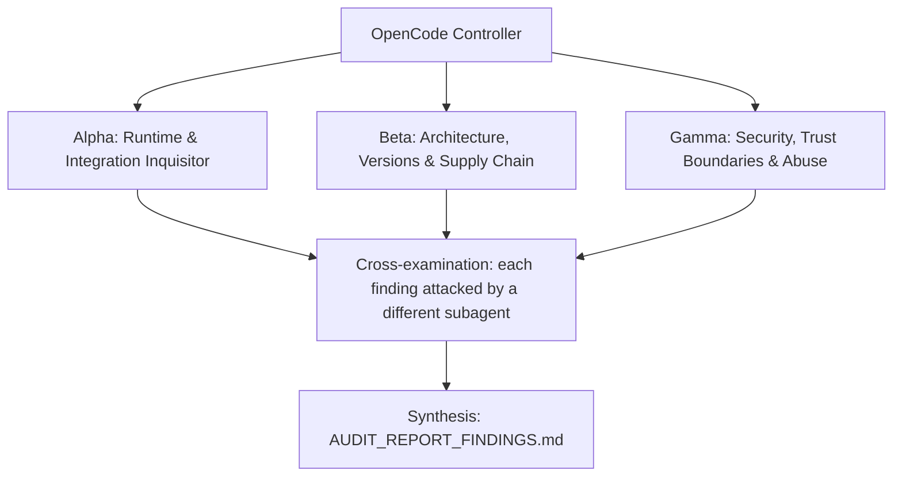

# ADVERSARIAL THREE-SUBAGENT AUDIT PROMPT: `openrig` (agent-app session continuity)

**Target Codebase**: the Git repository this file sits in. Resolve it with `git rev-parse --show-toplevel` and treat every path below as relative to that root. Nothing in this prompt depends on where the checkout lives. Audit the branch `feat/agent-app-session-continuity`. Its base is `ca1ee698`, or `upstream/main` if the branch was rebased. Use `BASE=$(git merge-base HEAD upstream/main)` and audit the diff `$BASE..HEAD` together with every code path it touches.
**GitHub Remote**: `https://github.com/Heretek-AI/openrig` (fork of `https://github.com/mvschwarz/openrig`)
**What it is supposed to be**: OpenRig runs AI coding agents as "seats" in tmux sessions, managed by a daemon (`packages/daemon`) and a CLI (`rig`, `packages/cli`). This branch adds **agent-app preset format 2**. A community agent app, described by `$OPENRIG_HOME/agent-apps/<name>.yaml`, can declare a `session` block:
- `id_pattern`: an anchored regex.
- `resume`: an argv holding `{session_id}`.
- `exists`: an argv whose exit 0 means present, exit 1 means missing, and anything else means unknown.
- `list`: an argv printing a JSON array of `{id, created, directory?}`.

The intended flow:
- **Capture.** At snapshot and `rig down`, OpenRig records which of the app's sessions the seat started. It records into a null token only, and only when exactly one candidate exists: created after the seat, in the seat's directory, and not held by another seat. The record has type `agent_app_session`.
- **Resume.** On `rig launch` or a restore, OpenRig first asks `exists`. On exit 1 it stops with "awaiting-decision" and types nothing. Otherwise it types the `resume` argv, every element single-quoted.
- **Unchanged.** Format-1 presets, fork, Claude, Codex, Pi, OMP and terminal seats behave exactly as before.
- **Security boundary.** Preset commands run as argv with `shell: false`. Session ids must pass a shell-inert floor (`^[A-Za-z0-9][A-Za-z0-9._-]{0,199}$`) and the preset's anchored pattern before reaching any command line. Ids are credential-class and never appear in errors or logs.
- **Target apps.** The motivating apps are OpenCode 1.x (`opencode`) and OpenCode 2.0 (`opencode2`). This is the first capability step of the "declarative preset table" path for discussion mvschwarz/openrig#43.
- **Scope.** One concern, no version bump, no CHANGELOG edit, no migration, no new dependency.

**Execution Context**: OpenCode v2 autonomous audit (works the same in any agent CLI that has subagents and a shell)
**Auditor Formation**: three independent adversarial subagents (Alpha, Beta, Gamma), a cross-examination pass, and a synthesis pass
**Output**: `AUDIT_REPORT_FINDINGS.md` at the repository root

This prompt is designed to be re-run. Each run audits the current `HEAD`, re-verifies every finding of the previous run, and overwrites `AUDIT_REPORT_FINDINGS.md`.

---

## 0. Preflight (the controller does this before spawning subagents)

1. **Baseline.** Record at the top of the report:
   - `git rev-parse HEAD`;
   - `git log -1 --format='%ci %s'`;
   - the UTC date;
   - the versions of every tool you will use (`node --version`, `npm --version`, `tmux -V`, `git --version`, `jq --version`, `sqlite3 --version`, and the exact OpenCode versions you install).

   If `git status --porcelain` shows changes other than this prompt file and a previous report, list the dirty files and audit a clean `git worktree` of `HEAD` instead of the working tree.
2. **Scratch space.** `export AUDIT_TMP="$(mktemp -d -t openrig-audit-XXXXXX)"`. Every clone, downloaded binary, packed tarball, sabotage copy, container volume and raw log goes under `$AUDIT_TMP`. Each subagent writes its raw notes to `$AUDIT_TMP/{alpha,beta,gamma}.md`.
3. **Disposable copy for experiments.** `git worktree add --detach "$AUDIT_TMP/wt" HEAD`. Sabotage, patched configs, and any file edits happen only there. The real checkout must end the audit with `git status --porcelain` showing nothing new but `AUDIT_REPORT_FINDINGS.md` (and this prompt file, if you copied it in untracked). Remove the copy with `git worktree remove --force "$AUDIT_TMP/wt"` at the end.
4. **Previous run.** If `AUDIT_REPORT_FINDINGS.md` already exists, read it before anything else. Every finding in it gets a row in the Regression Ledger (section 6), re-verified from scratch: never copy a previous verdict forward.
5. **Network and host capabilities.** You need outbound HTTPS to:
   - github.com and raw.githubusercontent.com;
   - registry.npmjs.org, to install `opencode-ai` and `@opencode-ai/cli` under `$AUDIT_TMP`.

   Probe what this host can do and record it:
   - `tmux -V`;
   - whether `npm i --prefix "$AUDIT_TMP/oc1" opencode-ai@1` succeeds;
   - whether `npm i --prefix "$AUDIT_TMP/oc2" @opencode-ai/cli@beta` succeeds;
   - whether the installed binaries run (`--version`);
   - free disk and CPU count, since the full daemon suite takes about 20 minutes.

   When a check cannot run here, the claim is `UNVERIFIABLE` with the exact reason. A claim is never `VERIFIED` by inference, by reading the code alone, or because a test says so.

**Hard limits (all subagents):**
- No package publishing, no `git push`, no tags, no GitHub writes (issues, comments, PRs).
- No real API keys or credentials in any command, file or report. Generate throwaway keys and dummy values.
- No destructive command outside `$AUDIT_TMP`.
- Read-only against the real checkout.
- Every daemon, tmux server and agent app runs with `HOME`, `OPENRIG_HOME`, `XDG_DATA_HOME`, `XDG_CONFIG_HOME` and the tmux socket under `$AUDIT_TMP`. Never touch the real `~/.openrig`, `~/.local/share/opencode` or the default tmux server.
- Never sign OpenCode in to a provider. An unauthenticated prompt still creates a session, which is all you need.
- Never `pkill -f opencode` or similar broad kills: they can kill your own shell. Kill by PID or by tmux socket.
- Loopback ports only. Stop every daemon you start (`rig daemon stop` with the scratch env, or kill its PID).

---

## 1. Directive & Rules of Engagement

You are a team of **three elite, adversarial principal systems auditors**. Your mandate is to stress-test, debunk, and verify every claimed feature, architectural decision, integration contract, security invariant, and version pin in **`openrig`**, measured against:
- what the repository is supposed to be (above);
- what its own `README.md`, `docs/reference/agent-app-presets.md` and PR body claim;
- the implementation brief the branch was built from.

### The Cardinal Rule: DO NOT BELIEVE TESTS
- Unit tests, acceptance scripts and CI badges can lie: they assert obsolete invariants, mock away the real system, or test that a file *contains* a rule rather than that the rule *works*.
- This branch has exactly those risks, by construction:
  - Every end-to-end test drives `packages/daemon/test/fixtures/agent-app/synth-session-app.mjs`, a **hand-written imitation of OpenCode**. It was modelled on OpenCode 1.19.3 and 2.0 beta-19271 as observed on 18 October 2026. Nothing in the suite runs real OpenCode through OpenRig. If OpenCode's `session list` output, `export` exit codes, or `--session` behaviour differ from the imitation, every test still passes.
  - `test/agent-app-session-resume.test.ts` injects `sessionExists` into the adapter and `captureAgentAppSession` into the refresher. It never runs the real `exists` or `list` path.
  - The integration test runs the daemon and the seat with the **same** `HOME` and `PATH`. Real machines often differ: a launchd or systemd daemon has a minimal `PATH`. A preset whose program is only on the user's shell `PATH` then gets `null` from `exists` and `list`, so it resumes without the missing-session check and never captures. No test covers this.
  - The code and tests were written by the planner and applied as patches by a coding agent. Agreement between code and tests proves only that the patches applied. It does not prove the brief's facts about OpenCode were right.
  - On a plain container the full daemon suite already had about 24 failing files on the base commit. A "green except known failures" report can hide a new failure if the baseline list was wrong.
  - When integration files run in parallel, the daemon times out (`did not respond in time`). A flaky pass or fail there proves nothing either way.
- Never conclude that a component works because `npm run build && npm run lint && (cd packages/daemon && npx vitest run)` exits 0. Prove behavior against **the real thing it plugs into**:
  - **real OpenCode 1.x and 2.0**, installed from npm into `$AUDIT_TMP`, run by a **real OpenRig daemon and `rig` CLI** built from this branch, on a private tmux socket;
  - **the real SQLite database** the daemon writes (`$OPENRIG_HOME/openrig.sqlite`; confirm the actual filename with `ls "$OPENRIG_HOME"`);
  - **the upstream OpenCode source** for `session list`, `export` and `--session` (`https://github.com/sst/opencode`, or the repository the npm package's `repository` field names) at the version you installed and at its current head.

### The Second Rule: DO NOT BELIEVE THE PAPER TRAIL
- These are **claims under audit**, not evidence:
  - the PR body (`PR_BODY.md` if present);
  - `docs/reference/agent-app-presets.md`;
  - the implementation brief (`IMPLEMENTATION_PROMPT.md`);
  - the coding agent's `NOTES.md`;
  - commit messages;
  - `README.md`.
- The repo was built by a coding agent applying patches from `IMPLEMENTATION_PROMPT.md`. That brief was written by a planner who verified OpenCode behaviour once, on one machine. Build gates that only check spec compliance cannot catch invented or outdated facts (CLI flags, JSON fields, exit codes, timestamp units) in the spec. Matching the spec is not the same as working. Where the spec and reality disagree, reality wins and the spec is the defect.

### The Third Rule: SABOTAGE EVERY CRITICAL INVARIANT
- For each invariant marked **[S]** in section 3:
  1. Break it with a one-line change in `$AUDIT_TMP/wt`.
  2. Run the relevant suite there: the four agent-app unit files, then the two integration files one at a time, after `npm run build`.
  3. Record whether the suite went red.
  4. Restore the line after each run.
- A sabotage the suite does not catch is a finding: **P1** ("untested invariant"), or **P0** when the invariant is a security boundary.

### Modern Version & Proper Deployment Imperative
- Every pinned version must be a **modern, supported, production-grade release that actually exists** in its registry. Flag:
  - invented versions;
  - deprecated or archived packages;
  - renamed organizations;
  - floating tags (`latest`, `^` ranges on security-relevant deps, unpinned GitHub Actions);
  - end-of-life runtimes;
  - versions with known CVEs (the ecosystem's audit tool, OSV: `https://api.osv.dev/v1/query`).
- Verify that integration patterns follow the **official upstream documentation and source code** of the system being integrated, at the version pinned and at the current upstream head. Drift is a finding.

### Verdict vocabulary
Every claim in section 3 ends with exactly one status, each backed by a command and its output:
- `VERIFIED`: proven to work against the real thing.
- `PARTIAL`: works with caveats you name.
- `BROKEN`: proven not to work.
- `UNVERIFIABLE`: could not be run here, with the exact reason.

---

## 2. The Adversarial Triad (Subagent Roles)



### Subagent Alpha: Runtime & Integration Inquisitor

**Focus:** Does a real OpenCode 1.x and 2.0 seat, run by a real OpenRig daemon from this branch, get its conversation captured at snapshot and resumed by `rig launch`? And does OpenRig stop, instead of opening a blank conversation, when the session is gone?

- **Install the real apps.** Install `opencode-ai@1` and `@opencode-ai/cli@beta` (binary `opencode2`) under `$AUDIT_TMP`, each with its own scratch `HOME`. Record exact versions. Re-derive section 4.2 of the brief yourself:
  - the `session list --format json` field names and units (is `created` epoch **milliseconds**?);
  - whether rows carry `directory`;
  - whether 1.x lists other directories' sessions outside a git repository;
  - `export <id>` exit codes for present and missing ids;
  - what `--session <unknown>` does on each version.

  Any difference from the brief is a finding against the claim that depends on it.
- **Run the whole flow on real OpenCode.** Use format-2 presets exactly as `docs/reference/agent-app-presets.md` shows (`opencode` and `opencode2` variants), installed into a scratch `OPENRIG_HOME/agent-apps/`. Then:
  1. `rig up` a one-member rig whose `runtime` is the preset name.
  2. `rig send` one prompt, so a session is created. No provider sign-in: the request fails, but the session must exist. Confirm with `session list`.
  3. `rig snapshot`, then read `resume_type`/`resume_token` from SQLite.
  4. Kill the seat's tmux session, then `rig launch <rig> <member> --json`.
  5. Assert `launched[0].status == "resumed"` and that the OpenCode screen shows the earlier prompt.

  Repeat for both versions. Then delete the session with OpenCode's own `session delete` if it exists, or remove its storage. Re-launch and expect `awaiting-decision` with no new tmux session. On 2.0 this is the critical case.
- **Run the same flow through the restore path,** not just `rig launch`: `rig down` then `rig up <rig> --existing` (or the restore command the README names). Confirm the token captured at `rig down` (refresh without `fillNullOnly`) is used.
- **Daemon environment differs from seat environment.** Start the daemon with a `PATH` that lacks the OpenCode binary while the seat's shell has it. Observe:
  - whether capture silently records nothing;
  - whether resume skips the missing-session check (the `null` path);
  - what the user sees.

  Then decide whether the docs page's "with the daemon's environment" warns enough.
- **Timing.** Measure how much `session list` adds to `rig snapshot` and `rig down` on 1.x with 1, 3 and 10 uncaptured agent-app seats. Measure whether the periodic snapshot scheduler re-runs `list` every tick for a seat that never received a prompt.
- **Regression of the old behaviour.** Run `packages/daemon/test/agent-app-runtime.integration.test.ts` alone (11 tests) and the format-1 flow by hand: resume refused, `--fresh` works. Confirm Claude/Codex seats in a mixed rig are unaffected (`test/restore-orchestrator.test.ts`, `test/resume-metadata-refresher.test.ts`).

### Subagent Beta: Architecture, Versions & Supply Chain

**Focus:** Is the change the right shape for discussion #43 and the upstream codebase, with one concern, no hidden scope, correct versioning of the preset format, and claims that match upstream OpenCode at its pinned version and at its head?

- **Format versioning.**
  - Format 1 files must load unchanged, and `session` in a format-1 file must still be refused as an unknown field.
  - Format 3 must be refused with `this OpenRig reads formats 1 and 2`.
  - Check every consumer of `AGENT_APP_PRESET_FORMAT` (`rg -n "AGENT_APP_PRESET_FORMAT" packages`) for a place that now writes or advertises 2 where 1 was meant.
- **Upstream OpenCode contract.**
  - Locate the source of `session list`, `export` and the TUI `--session` handling in the OpenCode repository at the installed versions' tags and at `HEAD`.
  - Quote the lines that fix the JSON shape and the exit codes.
  - Flag any field the brief relies on (`created`, `directory`) that upstream documents as unstable, renamed, or seconds-based.
- **Scope against the brief and the repository's rules.** `git diff --stat $BASE..HEAD` must touch only the 16 paths in the brief's section 5:
  - no `package.json` or lockfile change;
  - no migration under `packages/daemon/src/db/migrations`;
  - no `CHANGELOG.md` edit;
  - no version bump.

  `node scripts/check-docs-guard.mjs` must pass with the new doc tracked.
- **Upstream fit.**
  - Re-read discussion #43 (`https://github.com/mvschwarz/openrig/discussions/43`) and the maintainer's stated plan (a declarative preset table, then ACP).
  - Decide whether a `session` block of argv templates fits that table or forks it.
  - Check whether `upstream/main` has moved on `agent-app-presets.ts`, `agent-app-runtime-adapter.ts`, `restore-orchestrator.ts`, `resume-metadata-refresher.ts` or `session-registry.ts` since `$BASE`, and whether the branch still rebases cleanly (`git rebase --onto upstream/main $BASE` in `$AUDIT_TMP/wt`).
- **Wire compatibility.** A new CLI against an old daemon (no `resume`, no `resumes` fields) and an old CLI against a new daemon must both still print a sensible line. Check `packages/cli/src/commands/ps.ts` `formatAgentAppLine` and `packages/cli/src/commands/agent-app.ts`.
- **Toolchain.** Node `engines` (`^22 || ^24`), the actions in `.github/workflows/tests.yml` (are they pinned by SHA or by major tag?), and `npm audit --omit=dev` for anything this branch could have pulled in (expected: nothing new).

### Subagent Gamma: Security, Trust Boundaries & Abuse

**Focus:** Can a hostile or broken preset, a hostile session list, or a tampered database make OpenRig run an unintended command, type shell syntax into a seat, leak a session id, or attach one seat to another seat's conversation?

- **Shell injection corpus.** Build session ids and preset values that try to escape. Examples:
  - `ses_$(id)`, `` ses_`id` ``, `ses_'x'`, `ses_x;id`, `ses_x\nid`;
  - leading `-` (option injection such as `--help`, `-c`), and `..`;
  - 201-character ids, Unicode look-alikes, a NUL byte, surrounding whitespace.

  Feed them in three ways:
  - (a) through a tampered `sessions.resume_token` row in a scratch database, followed by `rig launch`;
  - (b) through a `list` command that prints them;
  - (c) through `checkAgentAppSessionId` directly.

  For each, record whether anything reached `spawn` or the pane. The floor refuses a leading `-` or `.`. Confirm that `--help`, `-c` and `..` never reach `opencode --session <id>` or `opencode export <id>` by any of the three routes, even with a permissive preset pattern such as `^.+$`.
- **Preset abuse.** Check each of these and record the behaviour:
  - `id_pattern` with catastrophic backtracking (ReDoS such as `^(a+)+$`) against a long id;
  - `resume`, `exists` or `list` naming `sh`/`bash -c` explicitly (the preset author's choice, but does the docs page warn?);
  - placeholder smuggling (`{session_id}` inside a larger element, as the program, in `list`);
  - YAML anchors, aliases and tags;
  - a `list` that prints more than 1 MiB, never exits, or exits 0 with non-JSON.

  Confirm the timeout (60 s) and the cap (1 MiB) actually kill the child (`ps` after the call).
- **Id never leaks.** Grep every error path and log line the branch adds or touches (`rg -n "error|console\.|log\(|emit" packages/daemon/src/domain/agent-app-sessions.ts packages/daemon/src/adapters/agent-app-runtime-adapter.ts packages/daemon/src/domain/resume-metadata-refresher.ts`). Then trigger each failure for real and search the daemon log, CLI output, events table and snapshot JSON for a known canary id. Snapshot JSON is expected to hold tokens: check how existing Claude/Codex tokens are treated there, and whether agent-app ids get the same redaction everywhere else (`packages/daemon/src/domain/resume-token-validation.ts`).
- **Cross-seat capture.** Run two seats of the same app in the **same** cwd, started within a second of each other, and send a prompt to each. Capture must record nothing (ambiguous) or the right id for each, never the other seat's id. Then repeat in **different** directories under OpenCode 1.x outside a git repo, where the list crosses directories. Also try a seat whose cwd is a symlink to another seat's cwd.
- **Fail-open paths.** `exists` returning `null` lets a resume proceed.
  - Prove what happens on 2.0 when `exists` times out, or the binary is missing from the daemon `PATH`, and the id is gone: does the user get a blank conversation reported as `resumed`?
  - Grade it, then propose the fail-closed alternative and its cost.
  - Also check that a token with `resume_type` other than `agent_app_session` (a Claude token left from a former runtime) is never typed into an agent-app seat.

---

## 3. Comprehensive Inventory of Claimed Functions & Architectural Decisions

### Domain 1: Preset format 2

* **Claim 1.1 [B][S]**: `loadAgentAppPreset` reads formats 1 and 2 only; format 3 is refused with `it declares format 3; this OpenRig reads formats 1 and 2` (`packages/daemon/src/domain/agent-app-presets.ts`).
* **Claim 1.2 [B][S]**: A format-1 preset with a `session` key is refused as `unknown field session (format 1 has format, name, command, maintainer, limits)`; format-1 presets otherwise load exactly as on the base commit.
* **Claim 1.3 [G][S]**: `parseArgv` refuses a string instead of a list, an empty element, an element holding a newline or NUL, `{session_id}` inside a larger element, `{session_id}` as the program, a `resume` or `exists` without the placeholder, and a `list` with it.
* **Claim 1.4 [G]**: `id_pattern` must start with `^`, end with `$`, and compile; nothing bounds its run time against an id (ReDoS exposure is the preset author's).
* **Claim 1.5 [B]**: `agentAppResumes(name)` is true only for a usable preset with a `session` block; a missing or broken preset is launch-only.

### Domain 2: Session id safety

* **Claim 2.1 [G][S]**: `checkAgentAppSessionId` trims, then requires `/^[A-Za-z0-9][A-Za-z0-9._-]{0,199}$/`, then the preset pattern, before any id reaches `spawn` or a pane (`packages/daemon/src/domain/agent-app-sessions.ts`).
* **Claim 2.2 [G][S]**: No error string, log line or event added or touched by this branch contains a session id; `Resume refused for agent app "<name>": <reason>. No session was started.` names no id.
* **Claim 2.3 [G][S]**: `runArgv` spawns with `shell: false`, ignores stderr, keeps stdout only when asked, caps it at 1 MiB and kills the child on timeout (60 s); it never throws.
* **Claim 2.4 [G][S]**: The only text typed into a seat for a resume is `shellLineFor(renderSessionArgv(spec.resume, id))`, every element single-quoted with the repo's `shellQuote`.
* **Claim 2.5 [G][S]**: An id beginning with `-` or `.` is refused by the floor, whatever the preset's pattern, so it can never become an option or a path argument of the app's `exists` or `resume` command.

### Domain 3: Resume in the adapter

* **Claim 3.1 [A][S]**: With a token and a `session` block, `AgentAppRuntimeAdapter.launchHarness` asks `exists` **before** typing anything; exit 1 returns `{ ok: false, recovery: "retry_fresh", missingConversation: true }` with the error `agent app "<name>" reports that the saved conversation no longer exists`, and nothing is typed.
* **Claim 3.2 [A]**: `exists` returning `null` (not declared, timeout, spawn error, other exit code) lets the resume go ahead; this is the intended fail-open.
* **Claim 3.3 [A][S]**: A successful resume returns `{ ok: true, resumeToken: id, resumeType: "agent_app_session" }`, and the startup orchestrator stores it on the new session.
* **Claim 3.4 [A][S]**: A format-1 preset keeps the exact old refusals for resume and fork; a format-2 preset refuses fork with `declares resume but not fork`.
* **Claim 3.5 [A]**: Against real OpenCode 2.0, a deleted session produces `awaiting-decision` from `rig launch`, never a blank conversation reported as `resumed`.

### Domain 4: Restore gates

* **Claim 4.1 [A][S]**: `snapshotLaunchOutcome` and the pre-launch check in `packages/daemon/src/domain/restore-orchestrator.ts` let an agent-app seat resume only when `resumeType === "agent_app_session"` **and** the installed preset declares `session`.
* **Claim 4.2 [G][S]**: A token of any other type on an agent-app seat (for example a Claude token from a former runtime) is never resumed by the agent-app adapter.
* **Claim 4.3 [A]**: A removed or broken preset turns a previously resumable seat back into launch-only (awaiting-decision), not an error or a fresh start.
* **Claim 4.4 [A]**: A pod-aware restore never silently falls back to a fresh session after a failed agent-app resume.

### Domain 5: Capture

* **Claim 5.1 [A][S]**: `ResumeMetadataRefresher.refresh` fills a **null** token for an agent-app seat (`agentAppOf(session.agentApp, session.runtime)`) and never replaces a present one, with or without `fillNullOnly`.
* **Claim 5.2 [A][S]**: An agent-app seat never reaches the Claude, Codex or Pi capture branches.
* **Claim 5.3 [G][S]**: `pickSeatSession` records an id only when exactly one row was created at or after the seat's `sessions.created_at`, in the seat's cwd or its `realpath` (or reports no directory), is not held by another session, and passes the id checks.
* **Claim 5.4 [A]**: `sqliteUtcToMs` reads `sessions.created_at` as UTC; capture works on a host whose local time zone is not UTC (run with `TZ=Pacific/Kiritimati` and `TZ=America/Los_Angeles`).
* **Claim 5.5 [A]**: Real OpenCode 1.x and 2.0 report `created` in epoch milliseconds and `directory` matching the seat cwd, so capture records the right id on both.
* **Claim 5.6 [G]**: A free-text seat whose runtime string merely matches a preset name is never captured or resumed as an agent app.
* **Claim 5.7 [A]**: `getLatestLiveSessions` selects `agent_app` through `sessionAgentAppSelect(this.db)` and still works on a database without the `agent_app` column.

### Domain 6: Labels, wire and docs

* **Claim 6.1 [B]**: `GET /api/agent-apps` adds `resumes: boolean`; `rig agent-app list` adds `Its preset declares resume, so a restore continues the conversation.` only when true.
* **Claim 6.2 [B]**: `rig ps --nodes` adds `; resume declared|not declared` and prints the old line unchanged when an older daemon omits the field.
* **Claim 6.3 [A][B]**: The two OpenCode presets in `docs/reference/agent-app-presets.md` work verbatim against the real OpenCode versions installed (Alpha's flow uses them unedited).
* **Claim 6.4 [B]**: Every behaviour the docs page states (60 s timeout, daemon environment, id floor (leading letter or digit, at most 200 characters), first-message session creation) matches the code.

### Domain 7: Packaging, release and scope

* **Claim 7.1 [B]**: `git diff --stat $BASE..HEAD` touches only the 16 paths listed in the brief's section 5; no `package.json`, lockfile, migration, `CHANGELOG.md` or version change.
* **Claim 7.2 [B]**: `npm run build` and `npm run lint` exit 0 on `HEAD`.
* **Claim 7.3 [B]**: `node scripts/check-docs-guard.mjs` exits 0 with `docs/reference/agent-app-presets.md` tracked, and the page ships in the package (`scripts/build-package.sh` copies `docs/reference/`).
* **Claim 7.4 [A][B]**: The full daemon suite has no failing file that does not also fail on `$BASE` in the same environment.
* **Claim 7.5 [B]**: The branch rebases onto current `upstream/main` without conflict, or the conflicts are listed.

### Domain 8: Ecosystem fit and CI

* **Claim 8.1 [B]**: The `session` block is expressible as rows of the declarative preset table the maintainer proposed in discussion #43, without OpenCode-specific code in OpenRig core (`rg -n -i "opencode" packages/daemon/src packages/cli/src` finds nothing added by this branch).
* **Claim 8.2 [B]**: `.github/workflows/tests.yml` runs the new unit tests; whether it runs the new integration test (it needs tmux) is stated.
* **Claim 8.3 [B][G]**: The GitHub Actions used by CI are pinned (record whether by SHA or by major tag) and none of the jobs touched by this branch gained permissions.

---

## 4. Reality-Check Recipes

```bash
set -u
ROOT="$(git rev-parse --show-toplevel)"; cd "$ROOT"
: "${AUDIT_TMP:?run preflight first}"; mkdir -p "$AUDIT_TMP/logs"
BASE="$(git merge-base HEAD upstream/main 2>/dev/null || echo ca1ee698)"
git diff --stat "$BASE"..HEAD | tee "$AUDIT_TMP/logs/diffstat.txt"
git diff --name-only "$BASE"..HEAD | rg -n "package(-lock)?\.json|CHANGELOG|migrations/" && echo "SCOPE: unexpected file" || echo "SCOPE: ok"

# Engines and format constant, read from the repo, not from this prompt
jq -r '.engines.node' package.json
rg -n "AGENT_APP_PRESET_FORMAT|READABLE_FORMATS" packages/daemon/src/domain/agent-app-presets.ts

# Real OpenCode, isolated (no sign-in, scratch HOME each)
npm i --prefix "$AUDIT_TMP/oc1" opencode-ai@1 >"$AUDIT_TMP/logs/oc1-install.txt" 2>&1
npm i --prefix "$AUDIT_TMP/oc2" @opencode-ai/cli@beta >"$AUDIT_TMP/logs/oc2-install.txt" 2>&1
OC1="$AUDIT_TMP/oc1/node_modules/.bin/opencode"; OC2="$AUDIT_TMP/oc2/node_modules/.bin/opencode2"
"$OC1" --version; "$OC2" --version
npm view opencode-ai version; npm view @opencode-ai/cli dist-tags --json
mkdir -p "$AUDIT_TMP/h1" "$AUDIT_TMP/h2" "$AUDIT_TMP/w1" "$AUDIT_TMP/w2"
(cd "$AUDIT_TMP/w1" && HOME="$AUDIT_TMP/h1" timeout 120 "$OC1" session list --format json) | tee "$AUDIT_TMP/logs/oc1-list.json"
(cd "$AUDIT_TMP/w2" && HOME="$AUDIT_TMP/h2" timeout 120 "$OC2" session list --format json) | tee "$AUDIT_TMP/logs/oc2-list.json"
# Known-bad input proves the exists check can say "missing": both must print 1
(cd / && HOME="$AUDIT_TMP/h1" timeout 120 "$OC1" export ses_doesnotexist0000000000 >/dev/null 2>&1; echo "oc1 missing=$?")
(cd / && HOME="$AUDIT_TMP/h2" timeout 120 "$OC2" export ses_doesnotexist0000000000 >/dev/null 2>&1; echo "oc2 missing=$?")
# Create a real session without credentials, then re-list (expect one row with created in ms, directory = w2)
tmux -S "$AUDIT_TMP/tmux.sock" new-session -d -s oc2 -c "$AUDIT_TMP/w2" "env HOME=$AUDIT_TMP/h2 $OC2"
sleep 8; tmux -S "$AUDIT_TMP/tmux.sock" send-keys -t oc2 "say pong" Enter; sleep 8
(cd "$AUDIT_TMP/w2" && HOME="$AUDIT_TMP/h2" "$OC2" session list --format json) | jq '.[0] | {id, created, directory, createdIsMs: (.created > 1e12)}'
tmux -S "$AUDIT_TMP/tmux.sock" kill-server

# Unit and integration suites (integration one file at a time, after a build)
npm run build >"$AUDIT_TMP/logs/build.txt" 2>&1; echo "build=$?"
npm run lint >"$AUDIT_TMP/logs/lint.txt" 2>&1; echo "lint=$?"
node scripts/check-docs-guard.mjs; echo "docs-guard=$?"
(cd packages/cli && npx vitest run test/agent-app-line.test.ts)
(cd packages/daemon && npx vitest run test/agent-app-sessions.test.ts test/agent-app-session-resume.test.ts test/agent-app-runtime.test.ts)
(cd packages/daemon && npx vitest run test/agent-app-session.integration.test.ts)
(cd packages/daemon && npx vitest run test/agent-app-runtime.integration.test.ts)

# Id floor and injection corpus straight through the helper (expect every line ok:false, and no id in error text)
cat > "$AUDIT_TMP/ids.mts" <<'EOF'
import { checkAgentAppSessionId } from "./packages/daemon/src/domain/agent-app-sessions.ts";
const spec = { idPattern: "^ses_[A-Za-z0-9]{8,40}$", resume: ["x", "{session_id}"] };
for (const id of ["ses_$(id)", "ses_`id`", "ses_'x'aaaaaaaa", "ses_x;idaaaaaa", "ses_x\nidaaaaa", "--help", "-c", "..", "a".repeat(201), "ses_abc12345\u0000"]) {
  const r = checkAgentAppSessionId(spec, id); console.log(JSON.stringify({ id, ok: r.ok, leaks: !r.ok && r.error.includes(id) }));
}
EOF
cp "$AUDIT_TMP/ids.mts" "$AUDIT_TMP/wt/ids.mts" && (cd "$AUDIT_TMP/wt" && npx tsx ids.mts; rm ids.mts)

# Id leak grep across touched sources
rg -n "error:|console\.|\.log\(|emit\(" packages/daemon/src/domain/agent-app-sessions.ts packages/daemon/src/adapters/agent-app-runtime-adapter.ts packages/daemon/src/domain/resume-metadata-refresher.ts | rg -i "id|token" || true

# Full-suite comparison against the base, same host
git worktree add --detach "$AUDIT_TMP/base" "$BASE" >/dev/null && (cd "$AUDIT_TMP/base" && npm ci >/dev/null 2>&1 && npm run build >/dev/null 2>&1 && cd packages/daemon && npx vitest run >"$AUDIT_TMP/logs/base-suite.txt" 2>&1)
(cd packages/daemon && npx vitest run >"$AUDIT_TMP/logs/head-suite.txt" 2>&1)
for f in base head; do rg -o "FAIL  test/[^ ]+" "$AUDIT_TMP/logs/$f-suite.txt" | sort -u > "$AUDIT_TMP/logs/$f-fail.txt"; done
comm -13 "$AUDIT_TMP/logs/base-fail.txt" "$AUDIT_TMP/logs/head-fail.txt"   # new failures on HEAD
```

`tsx` may not be installed. If `npx tsx` is unavailable, run the corpus as a vitest file in `$AUDIT_TMP/wt/packages/daemon/test/` instead. Never add it to the real checkout.

**Sabotage targets** (one at a time in `$AUDIT_TMP/wt`; expected: the suite goes red each time):
- **1.1:** `READABLE_FORMATS` → `[1, 2, 3]` in `packages/daemon/src/domain/agent-app-presets.ts`.
- **1.2:** in `FIELDS_BY_FORMAT`, add `"session"` to format 1's list.
- **1.3:** in `parseArgv`, delete the `arg.includes("{session_id}")` whole-element check.
- **2.1:** `SAFE_ID` → `/^.{1,200}$/` in `packages/daemon/src/domain/agent-app-sessions.ts`.
- **2.2:** append `${id}` to the `doesn't match the preset's id_pattern` error.
- **2.3:** `shell: false` → `shell: true` in `runArgv`.
- **2.5:** `SAFE_ID` → `/^[A-Za-z0-9._-]{1,200}$/` (allow a leading `-` or `.`).
- **2.4:** in `shellLineFor`, `.map(shellQuote)` → `.map(String)`.
- **3.1:** in `packages/daemon/src/adapters/agent-app-runtime-adapter.ts`, `=== false` → `=== null` on the `sessionExists` check.
- **3.3:** drop `resumeToken: resumed` from the success return.
- **3.4:** make the launch-only resume refusal condition `opts.resumeToken && false`.
- **4.1:** in `packages/daemon/src/domain/restore-orchestrator.ts`, `agentAppSeatResumes` returns `!!runtime && agentAppResumes(runtime)`, dropping the resume-type check.
- **4.2:** the same location; remove the `&& !agentAppSeatResumes(...)` from the pre-launch gate only.
- **5.1:** in `packages/daemon/src/domain/resume-metadata-refresher.ts`, `if (!session.resumeToken)` → `if (true)`.
- **5.2:** delete the `continue;` after the agent-app branch.
- **5.3:** in `pickSeatSession`, `candidates.length === 1 ? candidates[0]!.id : null` → `candidates[0]?.id ?? null`, then separately delete the `!seat.heldIds.has(row.id)` condition.

Any sabotage that stays green is a finding.

---

## 5. Execution Directives for OpenCode

1. **Independent exploration.** Spawn Alpha, Beta and Gamma concurrently as three separate subagents. Hand each one this entire file plus its role. They must not read each other's notes until step 4. Each one works through the claims it owns (ownership is marked `[A]`, `[B]`, `[G]` in section 3) and may file findings on any claim.
2. **Run things.** Prefer executing to reading. Use the recipes in section 4 and any further commands you need (`git ls-remote`, `curl`, `jq`, `rg`, `npm view`, `npm i --prefix "$AUDIT_TMP/..."`, `npx vitest`, `tmux -S "$AUDIT_TMP/..."`, `sqlite3`, the built `rig` CLI from `packages/cli/dist/bin-wrapper.js`). Save the raw output of every command you cite under `$AUDIT_TMP/logs/`.
3. **Empirical Proof Mandate.** For every claim judged `BROKEN`, `PARTIAL`, insecure, or outdated, record:
   - the exact file path and line number (`path/to/file.ts:123`);
   - the exact command executed to prove it, runnable as written from the repository root;
   - the raw output, error message, or registry response (trimmed to the relevant lines, never paraphrased);
   - for upstream comparisons, the upstream file path and commit SHA you compared against.
4. **Cross-examination.** When all three are done, each finding is handed to a different subagent (Alpha's to Beta, Beta's to Gamma, Gamma's to Alpha), whose job is to refute it: re-run the proof, look for a misreading, a wrong upstream version, or an environment artifact. A refuted finding is dropped or downgraded, and the refutation is noted in the finding.
5. **Coverage gate.** Before synthesis, check that every claim ID in section 3 has a status. Any claim without one goes back to its owner.
6. **Synthesis.** The controller writes `AUDIT_REPORT_FINDINGS.md` in the structure below. It then cleans up: `git worktree remove` for each worktree, stop every daemon and `tmux -S "$AUDIT_TMP/..." kill-server`. Finally it confirms the real checkout has no changes apart from the report and this prompt file.

---

## 6. Report Structure: `AUDIT_REPORT_FINDINGS.md`

```markdown
# AUDIT_REPORT_FINDINGS: openrig (agent-app session continuity)

## Baseline
Commit, commit date, audit date (UTC), tool versions, host capabilities, and the list of checks that could not run here and why.

## Verdict
Three to six sentences: does `openrig` do what it is supposed to be, against the real systems it plugs into? Name the single most important thing to fix.

## Prioritized Defect Matrix
| ID | Priority | Claim | Location | Summary |
|----|----------|-------|----------|---------|

## Findings
### ORS-<claim-id>-<slug>: <title>
- **Priority:** P0 | P1 | P2 | P3
- **Claim:** <claim ID and text>
- **Location:** `path:line`
- **Proof:** the command(s), runnable from the repo root
- **Raw output:** fenced block, trimmed, verbatim
- **Why it matters:** one or two sentences, in terms of what breaks for a user
- **Remediation:** an exact, fail-closed diff or command sequence
- **Verify the fix:** the command that goes from failing to passing once fixed
- **Cross-examination:** who challenged it and what they found

## Claim Ledger
| Claim | Status | Evidence (command or finding ID) |
Every claim ID from section 3, no omissions.

## Sabotage Results
| Invariant | One-line sabotage (file:line, before -> after) | Suite result | Caught? |

## Regression Ledger
| Previous finding ID | Previous priority | Status now: FIXED / STILL OPEN / REGRESSED / NO LONGER APPLICABLE | Evidence |
(Write "First run" if there was no previous report.)

## Not Audited / Unverifiable
What could not be checked, why, and what a human needs to provide to check it.
```

**Finding IDs are stable across runs.** Use `ORS-<claim-id>-<short-slug>` (for example `ORS-3.1-blank-session-on-v2`) so the next run's Regression Ledger can match findings by ID.

**Priority definitions:**
- **P0 / Critical:**
  - the component does not work against its real host or upstream. Examples: real OpenCode 1.x or 2.0 does not resume through `rig launch`; capture records another seat's session; a deleted 2.0 session comes back as a blank conversation reported `resumed`; a format-1 preset or a Claude/Codex seat behaves differently from the base commit;
  - a security boundary can be bypassed;
  - a pinned artifact does not exist;
  - a release on a registry is broken.
- **P1 / High:** deprecated or end-of-life versions, fail-open error handling, an untested security or correctness invariant (sabotage survived), an integration contract that drifted from the current upstream head, severe scope or architecture drift from what the repo is supposed to be.
- **P2 / Medium:** non-fatal version lag, documentation that contradicts behavior, missing CI coverage for a reality check, suboptimal resource or performance choices.
- **P3 / Low:** style, dead code, naming, minor cleanups.

For every finding, provide the exact, fail-closed code diff or command sequence to remediate. Do not apply it to the real checkout.
